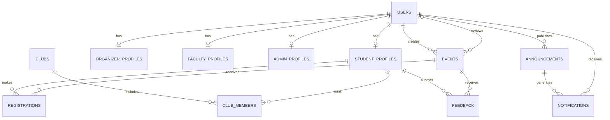

# ERD Summary

`users` owns common identity and role. Service-layer invariant: exactly one corresponding profile row for each enabled role type. A user's account should be disabled, not deleted, to preserve registrations/feedback/history.
